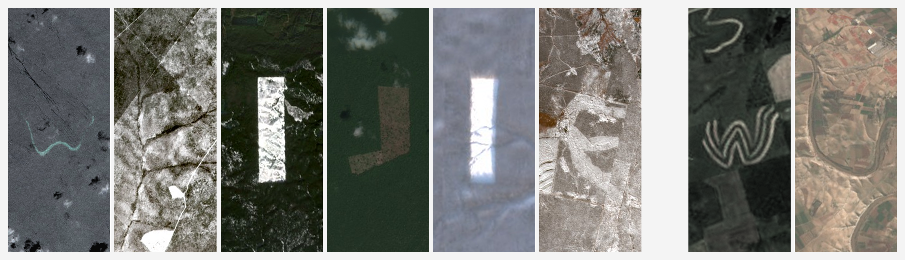

# Weijie Wu

[中文](README.md) | **English**

> PhD student · University of Chinese Academy of Sciences  
> Remote sensing foundation models / Geospatial representations / Agents  
> Open to multimodal AI / AI for Science internships

### Selected projects

**[EarthEmbeddingExplorer](https://github.com/go-bananas-wwj/EarthEmbeddingExplorer)** — Cross-modal retrieval of global satellite imagery · ICLR 2026 ML4RS Workshop  
[Paper](https://arxiv.org/abs/2603.29441) · [Code](https://github.com/OpenGeoScope/EarthEmbeddingExplorer) · [Demo](https://modelscope.cn/studios/WeijieWu/EarthEmbeddingExplorer)

---

**[InstructSAM](https://voyagerxvoyagerx.github.io/InstructSAM/)** — Instruction-oriented remote sensing object recognition · NeurIPS 2025  
[Paper](https://arxiv.org/abs/2505.15818) · [Project](https://voyagerxvoyagerx.github.io/InstructSAM/)

---

[Website](https://go-bananas-wwj.github.io/) · [ModelScope](https://modelscope.cn/profile/WeijieWu) · [Email](mailto:wuweijie25@mails.ucas.ac.cn)
