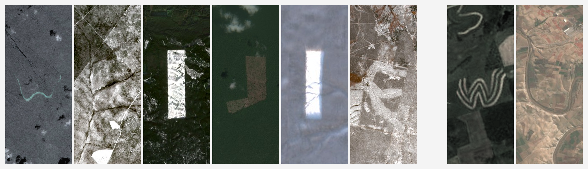

# 伍炜杰 / Weijie Wu

**中文** | [English](README.en.md)

> 中国科学院大学博士生 · 遥感大模型 / 地理表征 / 智能体  
> 寻找多模态大模型 / AI for Science 实习

### 研究项目

**[EarthEmbeddingExplorer](https://github.com/go-bananas-wwj/EarthEmbeddingExplorer)** — 全球卫星影像跨模态检索 · ICLR 2026 ML4RS Workshop  
[论文](https://arxiv.org/abs/2603.29441) · [代码](https://github.com/OpenGeoScope/EarthEmbeddingExplorer) · [演示](https://modelscope.cn/studios/WeijieWu/EarthEmbeddingExplorer)

---

**[InstructSAM](https://voyagerxvoyagerx.github.io/InstructSAM/)** — 指令驱动的遥感目标识别 · NeurIPS 2025  
[论文](https://arxiv.org/abs/2505.15818) · [项目](https://voyagerxvoyagerx.github.io/InstructSAM/)

---

[个人网站](https://go-bananas-wwj.github.io/) · [魔搭](https://modelscope.cn/profile/WeijieWu) · [邮箱](mailto:wuweijie25@mails.ucas.ac.cn)
